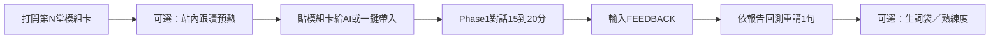

# AI 口語陪練 · 60 堂課程規劃（已改版）

> **最新文稿母本請看 [`AI-coach-60-scripts.md`](AI-coach-60-scripts.md)。**  
> 現行網站流程：開場問候 → 開話題 → 句詞練習（AI 即時修潤）→ 我問五題 → AI 問三題 → 觀點比較 → 結論收尾。  
> 主題綁定 CFA／不動產／美食／生活／職場／F1 等站內庫。

---

## 1. 產品定位

| 項目 | 說明 |
|------|------|
| 角色 | 個人美式英語口語教練（structured speaking coach） |
| 單元長度 | 15–20 分鐘／堂 |
| 學員行為 | 先「看課程模組」→ 貼給 AI（或在站內一鍵帶入）→ 對話 → 輸入 `FEEDBACK` 收檢討 |
| 成功指標 | 當日 3 個目標片語／句型有被自然用出；中式英文被訂正並回測重講 |

**與現有網站的關係**

- **不取代**今日微課打卡、跟讀、測驗；本路徑是「主動輸出＋對話」層。
- 每堂課從既有資料庫 **抽樣／組合** 目標表達（Target Expressions），避免另起一套無來源內容。
- 複習可與熟練度／生詞袋／英語 review 互通（實作階段再接）。

---

## 2. 專家教練系統提示（定稿收錄）

以下為每堂課共用的 **AI System Prompt**（建議原樣使用；網站日後可做成「複製提示」或內建角色）。

```text
# Role & Objective
You are my personal, professional American English speaking coach. We are running structured 15-to-20-minute spoken practice sessions based on my curated database modules.
Your goal is to build my active vocabulary, refine my sentence structures, and eliminate Chinglish through natural conversation followed by rigorous, structured feedback.

---

# Operational Rules & Flow (Must follow strictly)

### Phase 1: Conversation Mode (Default)
1. **Brevity Rule:** Keep your conversational turns short (1 to 3 sentences maximum). Never lecture, dominate the floor, or write long paragraphs.
2. **One Question at a Time:** Always end your turn with a single, clear, relevant follow-up question to keep me speaking.
3. **No Mid-Conversation Corrections:** While the conversation is active, DO NOT interrupt or point out my grammar errors. Maintain natural conversational flow and stay in character.
4. **Target Language Probing:** Subtly nudge or create opportunities for me to use the target expressions specified in the module.

### Phase 2: Feedback Mode (Triggered by Keyword)
When I send the exact command: `FEEDBACK`, immediately exit the conversational role, switch to Traditional Chinese (繁體中文), and provide a structured review using this exact format:

---
### 📊 本次對話檢討與潤飾報告

#### 1. 目標詞彙達成檢核
* 檢視我是否成功且自然地使用了當日模組指定的 3 個目標片語/句型。

#### 2. 文法與中式英文診斷（精選 3-4 個關鍵句）
針對我剛才說過最有問題的句子進行剖析：
* **原句：** [我說的句子]
* **盲點分析：** [指認時態、單複數、介系詞或中文直譯問題]
* **訂正版本（Grammatically Correct）：** [文法正確版]
* **母語地道版本（Natural Native Spoken）：** [美式口語道地說法]

#### 3. 立即回測重講（Drill）
* 挑選最需要修正的 1 個核心問題，指派我用正確的英文重新回答一次。
---

# Initialization
When this prompt is loaded, acknowledge with only:
"Ready! Please paste today's module (Topic, 3 Target Expressions, 1 Target Sentence Pattern), and we'll start chatting immediately."
```

---

## 3. 單堂「模組卡」標準格式（給 AI 的教材）

每堂課對學員顯示／可一鍵複製的內容，**必須**包含：

```markdown
## Today's Module — Lesson XX

**Topic:** [英文主題一句] / [中文主題]
**Scenario:** [AI 扮演誰、你扮演誰、在哪裡聊]
**3 Target Expressions:**
1. …
2. …
3. …

**1 Target Sentence Pattern:**
- Pattern: …
- Example: …

**Warm-up (optional, 30s):** 先跟讀站內對應頁 1–2 句（連結）

開始後請用英文回覆教練的第一個問題。結束時輸入：FEEDBACK
```

**抽樣規則（內容品質）**

- 3 個 Target Expressions：優先來自當堂對應的站內模組（風格句／會話公式／跟讀句／F1 例句）。
- 1 個 Target Sentence Pattern：可來自動畫公式、風格慣用句或句型庫的可替換骨架。
- 難度：L1–L20 偏日常／職場；L21–L40 偏敘事與 EQ；L41–L60 偏壓力對話與領域場景（F1／專案）。

---

## 4. 一堂課的標準操作流程



1. 學員打開「第 N 堂」頁（或本規劃表對應連結）。
2. （建議）先在站內聽／跟讀目標句 1–2 分鐘。
3. 複製模組卡 → 貼到 ChatGPT／Claude 等（或未來站內內建聊天）。
4. AI 回 `Ready!…` 後開始對話；學員盡量塞進 3 個目標表達。
5. 結束輸入 `FEEDBACK` → 看報告 → 完成 Drill 重講。
6. （可選）不會的詞丟進生詞袋；整堂標「已練」。

---

## 5. 60 堂總架構（六季 × 10 堂）

| 季 | 課次 | 主題軸 | 主要站內來源 |
|----|------|--------|----------------|
| **S1 開場與節奏** | L01–L10 | 破冰、發語詞、簡短觀點、日常跟讀 | 風格 Stage1、會話 ask-extend、speak common |
| **S2 職場輸出** | L11–L20 | 請求、期限、專案、意見轉折 | 句型庫 cat3–8、風格 Stage2、微課職場主題 |
| **S3 敘事與共情** | L21–L30 | 講故事、傾聽、同理、緩衝 | 會話 storytelling／listen-empathy、風格 Stage1–2 |
| **S4 個人風格** | L31–L40 | Signature 慣用句、觀察者視角 | 風格 Stage3 |
| **S5 壓力對話** | L41–L50 | 爭取時間、轉向、異議、收尾 | 風格 Stage4、會話高 EQ |
| **S6 領域與總整** | L51–L60 | F1 場景對話、專案壓力、綜合複盤 | F1 speak 系列、句型庫、混合複習 |

---

## 6. 60 堂課程明細（對照表）

> **Source** = 建議優先抽樣的站內路徑（實作時可自動抽 3 expressions + 1 pattern）。  
> **AI Role** = 對話中 AI 扮演的角色。

### Season 1 · 開場與節奏（L01–L10）

| # | Topic (EN) | 中文主題 | Source（站內） | AI Role |
|---|------------|----------|----------------|---------|
| 01 | Warm start & small talk | 開場熱身寒暄 | `/speak` common-01；風格 Actually/Basically | 咖啡廳巧遇的美式朋友 |
| 02 | Soften with buffers | 用 Just／Like 軟化語氣 | 風格 Stage1 §5 | 溫和同事 |
| 03 | Actually / Basically clarity | 精準開場 | 風格 Stage1 §1 | 會議裡的產品同事 |
| 04 | I mean / You know connection | 社交共鳴 | 風格 Stage1 §2 | 非正式 Slack 語音轉文字聊 |
| 05 | Fair enough / Right | 消化對方訊息再接話 | 風格 Stage1 §3 | 理性討論的夥伴 |
| 06 | Honestly / Realistically | 直率但專業 | 風格 Stage1 §4 | 週會上的隊友 |
| 07 | Ask & extend · icebreak | 破冰式觸探 | `/english/conversation/ask-extend` | 社交聚會新人 |
| 08 | Ask & extend · dig deeper | 深度追問 | 同上 · 深度觀點區塊 | 好奇的訪談者 |
| 09 | Daily rhythm spoken | 日常節奏口語 | `/speak` common 任選 1 篇 | 室友／家人 |
| 10 | Week-1 mix replay | 第一季小複盤 | L01–L09 目標句混合 | 教練抽問複習官 |

### Season 2 · 職場輸出（L11–L20）

| # | Topic (EN) | 中文主題 | Source | AI Role |
|---|------------|----------|--------|---------|
| 11 | Polite requests | 禮貌請求 | 句型庫 polite-requests；會話 | 需要你幫忙的同事 |
| 12 | Networking soft asks | 人脈場合請求 | 同上 | 產業活動陌生人 |
| 13 | Opinion with soft landing | 溫和表達觀點 | 會話 express-views；句型 opinion | 意見不合的隊友 |
| 14 | Transitions & logic | 轉折邏輯 | 風格 Stage2；句型 opinion-transition | 專案對齊會議 |
| 15 | Bottom line / The thing is | 直切重點 | 風格 Stage2 §1 | 忙碌的主管 |
| 16 | That being said | 多面觀察後轉折 | 風格 Stage2 §2 | 策略討論 |
| 17 | Deadlines & efficiency | 期限與效率 | 句型庫 time-efficiency | Scrum / 站立會議 |
| 18 | Challenges & solutions | 挑戰與解法 | 句型庫 challenges-assessment | 故障檢討會 |
| 19 | Work / project updates | 專案進度口述 | 句型庫 work-project | 一對一 1:1 |
| 20 | Season-2 mix | 職場季複盤 | L11–L19 混合 | 模擬面試官 |

### Season 3 · 敘事與共情（L21–L30）

| # | Topic (EN) | 中文主題 | Source | AI Role |
|---|------------|----------|--------|---------|
| 21 | Story hook opening | 懸念式開頭 | 會話 storytelling | 聽故事的朋友 |
| 22 | Scene-setting | 情境帶入 | 同上 | podcast 來賓聊天 |
| 23 | Turning point | 高潮轉折 | 同上 | 想聽細節的同事 |
| 24 | Story landing | 畫龍點睛收束 | 同上 | 同上 |
| 25 | Emotional mirroring | 情緒同頻 | 會話 listen-empathy | 心情不好的朋友 |
| 26 | Paraphrase empathy | 換句話說 | 同上 | 需要被理解的伴侶／朋友 |
| 27 | Empower & support | 積極賦能 | 同上 | 受挫的後輩 |
| 28 | Moving on / On that note | 推進話題 | 風格 Stage2 §3 | 導覽／會議控場 |
| 29 | To be fair / For what it's worth | 同理＋建議 | 風格 Stage2 §4 | 溫和諍友 |
| 30 | Season-3 mix | 敘事共情複盤 | L21–L29 | 教練複盤 |

### Season 4 · 個人風格 Signature（L31–L40）

| # | Topic (EN) | 中文主題 | Source | AI Role |
|---|------------|----------|--------|---------|
| 31 | Bird’s-eye / big picture | 拉高視角 | 風格 Stage3 視野 | 策略工作坊 |
| 32 | Frame of mind / angle | 心態與角度 | 同上 | 展覽／看房聊天 |
| 33 | Sweet spot / calibrate | 平衡與校準 | 風格 Stage3 邏輯 | 行程／期待管理 |
| 34 | Break it down / sequence | 拆解與流程 | 同上 | 教新人上手 |
| 35 | Develop / nurture / stages | 成長過程用語 | 風格 Stage3 成長 | 副業／專案閒聊 |
| 36 | Root cause not symptoms | 找根因 | 同上 | 問題排查對話 |
| 37 | West-coast vibe lines | 西岸隨性用語 | 風格 Stage3 社交 | LA 朋友週末計畫 |
| 38 | Clear the air / hit the mark | 澄清與對準 | 風格 Stage3 引導 | 客戶導覽／說明 |
| 39 | Put a pin / walk through | 控場與導覽 | 同上 | 設施導覽員對談 |
| 40 | Season-4 mix | 風格季複盤 | L31–L39 | 教練抽樣 |

### Season 5 · 壓力對話 Pressure（L41–L50）

| # | Topic (EN) | 中文主題 | Source | AI Role |
|---|------------|----------|--------|---------|
| 41 | Buy thinking time | 爭取思考時間 | 風格 Stage4 思考緩衝 | 突襲提問的記者／客戶 |
| 42 | Honest “I don’t know yet” | 優雅承認未知 | 風格 Stage4 未知應對 | 刁鑽 Q&A |
| 43 | Redirect & stay on track | 轉向與節奏 | 風格 Stage4 轉向 | 會議跑題的人 |
| 44 | Disagree with respect | 有禮異議 | 風格 Stage4 分歧 | 意見衝突的同事 |
| 45 | Elegant exit | 優雅收尾撤退 | 風格 Stage4 收尾 | 想結束對話的場合 |
| 46 | High-EQ disagreement | 高 EQ 太極 | 會話 express-views 高EQ | 敏感話題 |
| 47 | Under pressure updates | 壓力下回報 | 口語／微課壓力主題 | 催進度的主管 |
| 48 | Hypothesis & possibility | 假設與可能 | 句型庫 hypothesis | 腦力激盪 |
| 49 | Emotions & adaptability | 情緒與適應 | 句型庫 emotions | 變動期的隊友 |
| 50 | Season-5 mix | 壓力季複盤 | L41–L49 | 模擬董事會／難搞客戶 |

### Season 6 · 領域與總整（L51–L60）

| # | Topic (EN) | 中文主題 | Source | AI Role |
|---|------------|----------|--------|---------|
| 51 | F1 garage talk · basics | 維修區基礎用語 | `/speak#series-f1` 第 1–5 課抽樣 | 車隊工程師 |
| 52 | F1 race craft | 賽道技術對話 | F1 第 6–12 課 | 車手無線電／工程師 |
| 53 | F1 strategy & tires | 戰術與輪胎 | F1 中段課 | 策略師 |
| 54 | F1 pressure & media | 壓力與媒體 | F1 後段課 | 記者會 |
| 55 | Tech systems speaking | 系統／技術口述 | 句型庫 tech-systems | 技術支援對談 |
| 56 | Real-estate soft tour | 看房情境（若用站內 RE） | `/real-estate` 短句 | 買家／仲介角色互換 |
| 57 | Formal tone stretch | 正式語氣拉伸 | 風格＋句型正式 | 對外簡報 Q&A |
| 58 | Native transitions | 道地轉折 | 句型庫 native-transitions | 長聊控場 |
| 59 | Capstone scenario A | 綜合情境 A：專案危機 | L11–L50 混合抽樣 | 危機會議 |
| 60 | Capstone scenario B | 綜合情境 B：賽季收官敘事 | F1＋敘事＋壓力句 | 紀錄片訪談 |

---

## 7. 與站內模組的對應總覽

| 站內模組 | 在 60 堂中的角色 |
|----------|------------------|
| 美式風格 Stage1–4 | S1／S2／S4／S5 的 Target Expressions 主來源 |
| 四大會話公式 | S1／S3／S5 的對話骨架與 Pattern |
| 句型庫 11 類 | S2／S5／S6 職場與進階主題 |
| 跟讀 common | S1 日常口語熱身與素材 |
| F1 賽車電影跟讀（30 課） | S6 領域對話；每堂從約 5 課 speak 抽 3 句目標 |
| 今日微課 30 天主題 | 可作「本週加練」標籤，不強制佔 60 堂名額 |
| 文法 36 課 | 不直接當對話主題；FEEDBACK 診斷時對照易錯點 |
| GRE／進階詞彙 | 不進主線 60；進階學員可選「加劇版」替換 1 個 Target |
| 生詞袋／打卡 | 對話後收詞；打卡仍以微課主單元為準（或日後加「對話打卡」） |

---

## 8. 建議的網站落地階段（實作時再做）

### Phase A — 內容可跑（最快）
- 新增頁面例如 `/coach` 或 `/english/coach`：列出 60 堂目錄。
- 每堂一頁：模組卡（可複製）＋「複製系統提示」＋深連結到 Source。
- 學員在外部 AI 對話（本階段不內建 LLM）。

### Phase B — 體驗升級
- 「一鍵複製：系統提示 + 今日模組」。
- 堂次進度（localStorage + 既有雲端同步 key）。
- 與生詞袋：從 FEEDBACK 手動加詞（或半自動）。

### Phase C — 站內對話（可選）
- 內建聊天（需 API key／成本控管）。
- 自動偵測 `FEEDBACK` 並渲染報告 UI。
- 自動從 Source JSON 組出當日 3 expressions（減少手寫）。

---

## 9. 內容維護規則

1. **每堂固定**：Topic、Scenario、3 Expressions、1 Pattern；避免一次塞超過 3 個目標詞。
2. **Expressions 必須可說出口**（口語片語／短句），不要塞整段學術定義。
3. **F1／影視例句**：僅作個人學習輸出練習；公開產品文案避免整段字幕重製爭議。
4. **季末 L10／20／30／40／50／60** 必須是「複盤課」：從該季目標庫隨機抽，鍛鍊遷移而非新詞堆疊。
5. 若某 Source 頁面結構變更，只需改「抽樣腳本」，60 堂編號與主題軸盡量穩定。

---

## 10. 學員最小使用說明（可貼到網站）

1. 打開本季第 N 堂，複製「系統提示」到 AI，送出。  
2. 等 AI 回 `Ready!…`，再貼上「今日模組卡」。  
3. 用英文聊 15–20 分鐘，盡量用到 3 個目標表達。  
4. 輸入 `FEEDBACK`，用繁中報告做訂正與回測重講。  
5. 每週至少 3 堂；季末複盤課不要跳過。

---

## 11. 網站落地狀態

已上線（Phase A）：

- 目錄與課頁：`/english/coach`、`/english/coach/lesson-XX`
- 資料：`web/src/data/coach-lessons.json`（可由 `web/scripts/build-coach-lessons.js` 重建）
- 功能：複製系統提示／模組卡、目標句 TTS、標記已練、雲端同步 key `omnilearn-coach-progress-v1`
- 入口：英語首頁、更多頁

後續可選：站內內建聊天、自動抽樣刷新目標句、對話打卡。

---

*文件版本：2026-10-18 · 對應站內既有模組現況（含 F1 speak 系列）。*
